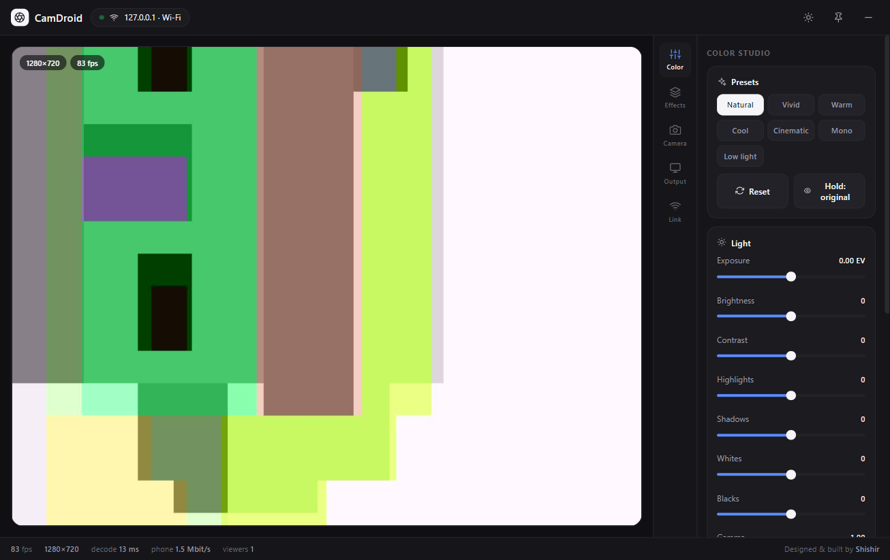
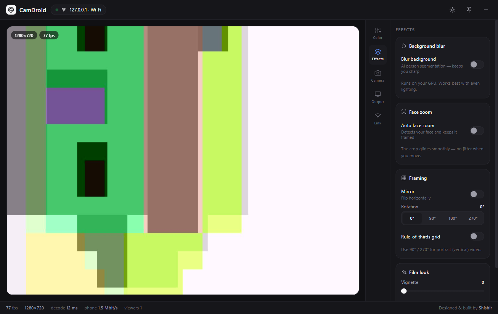
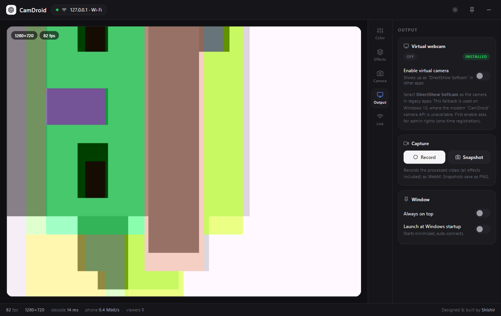
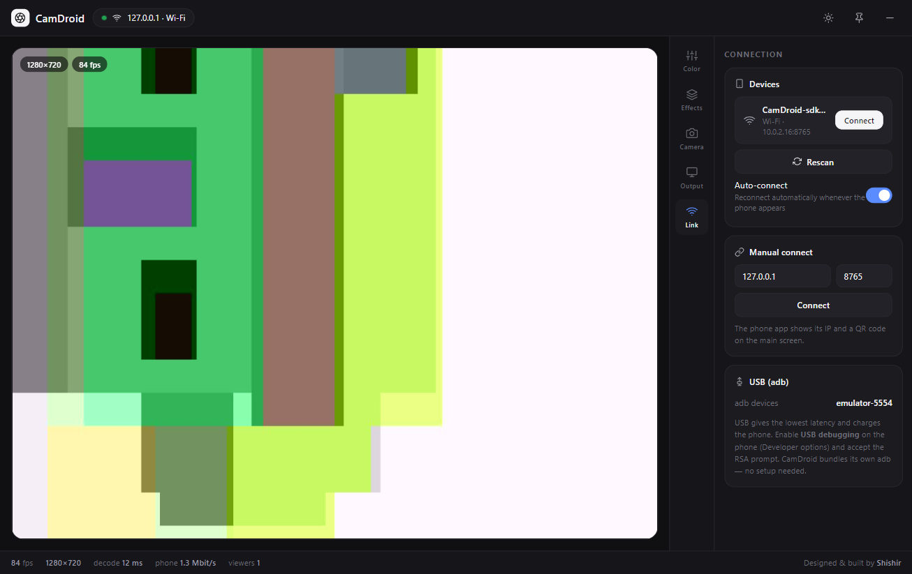
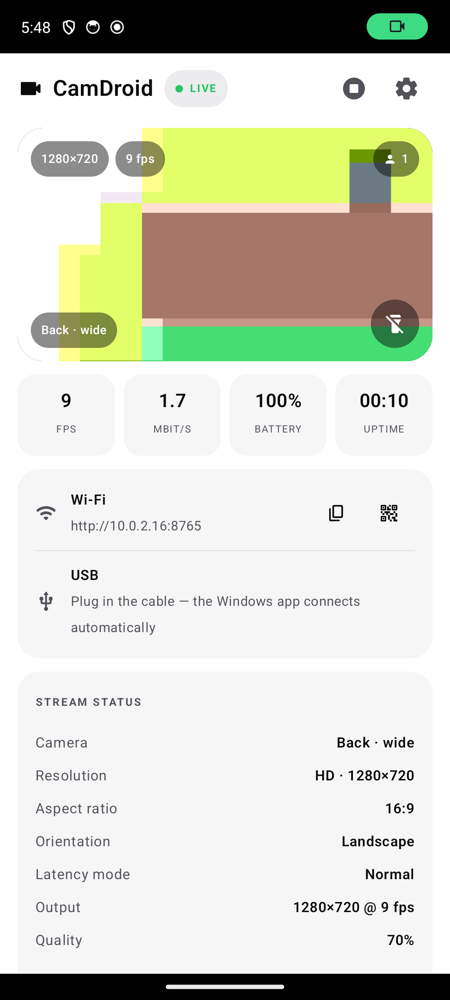
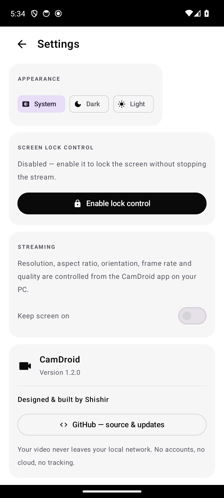

<div align="center">

# CamDroid

**Turn your Android phone into a wireless webcam for Windows — over Wi-Fi or USB.**

Use every camera on your phone (ultra-wide, main, tele, front) as a system-wide virtual camera in **Zoom, Microsoft Teams, Discord, OBS, Chrome, Edge** and any other camera app — with a full color studio, face zoom, background blur and ultra-low-latency streaming.

[](https://github.com/Shishir-ip/CamDroid/releases/latest)
[](LICENSE)
[](https://github.com/Shishir-ip/CamDroid/releases/latest)
[](https://github.com/Shishir-ip/CamDroid/releases/latest)
[](https://github.com/Shishir-ip/CamDroid/stargazers)

[**Download**](https://github.com/Shishir-ip/CamDroid/releases/latest) · [Features](#features) · [Quick start](#quick-start) · [Screenshots](#screenshots) · [Build from source](#build-from-source) · [FAQ](#faq)

</div>

---

CamDroid is a free, open-source **phone-as-webcam** app: a minimal Android app streams your camera, and a Windows companion app receives it, lets you grade and enhance the video, and outputs it as a real virtual camera that every application can see. No accounts, no cloud, no subscriptions — your video never leaves your local network.

## Features

**Connection**
- 📶 **Wi-Fi** with automatic discovery (mDNS) — open both apps and they find each other
- 🔌 **USB** via ADB — plug in the cable and the Windows app connects automatically
- 🔁 Auto-reconnect to your last phone whenever it appears

**Video & camera control (from the PC)**
- 🎥 Every phone lens: ultra-wide, main, telephoto, front
- 🖥️ Resolution presets — **SD, HD, Full HD, QHD, UHD/4K** — matched to what your phone actually supports (never above 4K)
- 📐 Aspect ratios **16:9** and **4:3**, for both portrait and landscape output
- 🔄 Orientation: **Auto** (follows how you hold the phone), **Portrait**, **Landscape** — works with the screen off
- ⚡ Latency modes: **Normal**, **Minimal** (lowest latency & heat), **Auto** (steps down when the phone heats up or battery is low)
- 🔍 Zoom, torch, exposure compensation, tap-to-focus

**Windows studio**
- 🎨 Color suite: exposure, brightness, contrast, highlights, shadows, whites/blacks, temperature, tint, hue, saturation, vibrance, gamma, sharpness + one-click presets
- 🧑 Face zoom with smooth automatic face tracking (MediaPipe)
- 🌫️ Background blur with adjustable strength (MediaPipe segmentation)
- 🪞 Mirror/rotation, vignette, film grain, composition grid
- ⏺️ Record processed video (WebM) and save PNG snapshots
- 🌗 Dark/light themes, tray mode, always-on-top, launch at startup

**Android**
- 🔒 Real screen-lock button — turn the screen off while the camera keeps streaming (foreground service + wake/Wi-Fi locks)
- 🌡️ Heat management: encoding pauses when nobody is watching; Auto mode reacts to thermal status
- 📱 Simple by design: the phone shows preview, connection info and live status — everything else is controlled from the PC

**Virtual camera output**
- 🪟 **Windows 11**: native Media Foundation virtual camera named **CamDroid** — visible to modern apps (Chrome, Edge, Zoom, Teams, Discord, OBS)
- 🪟 **Windows 10 / legacy apps**: Softcam DirectShow filter fallback
- 🖥️ Output resolution follows your phone stream automatically; keeps running when CamDroid is minimized to tray

## Quick start

1. **Install**
   - Windows: download **`CamDroid-Setup-x.y.z.exe`** from [Releases](https://github.com/Shishir-ip/CamDroid/releases/latest) and run it
   - Android: download **`CamDroid-x.y.z-release.apk`** from [Releases](https://github.com/Shishir-ip/CamDroid/releases/latest) and install it (allow install from unknown sources)
2. **Connect** — same Wi-Fi: open both apps, they auto-discover. Or plug in USB (enable USB debugging) — the Windows app connects by itself. Manual IP connect is always available.
3. **Use it** — in the Windows app, open the **Output** tab and enable the virtual camera (one-time admin approval on Windows 11). Then pick **CamDroid** as the camera in Zoom / Teams / OBS / your browser.

> **Windows 11 note:** the first enable registers the virtual-camera DLL (one-time UAC prompt). The camera appears as **CamDroid** in every app's camera list.

## Screenshots

| Windows — Color studio | Windows — Camera controls |
| --- | --- |
|  |  |

| Windows — Effects | Windows — Output & virtual camera |
| --- | --- |
|  |  |

| Windows — Connection | Android — Live stream | Android — Settings |
| --- | --- | --- |
|  |  |  |

## Build from source

**Requirements:** JDK 17+, Android SDK (API 35) · Node.js 20+ · VS 2022 C++ Build Tools + Windows 11 SDK (only to rebuild the virtual-camera DLLs)

```bash
# Android APK
cd android
./gradlew assembleRelease        # Windows: gradlew.bat

# Windows app + installer
cd windows
npm install
node build.mjs                   # renderer bundle
npm run dist                     # NSIS installer
```

Release signing is optional: create `android/keystore.properties` (see `app/build.gradle`) — without it the APK builds unsigned. Vendored binaries and their licenses are documented in [`windows/vendor/README.md`](windows/vendor/README.md).

## How it works

```
Android (CameraX → NV21 → JPEG)  ──MJPEG/HTTP──▶  Windows (WebGL pipeline)  ──shared memory──▶  Virtual camera
        ▲                                              │
        └──────────── control API (JSON) ◀─────────────┘
```

- The phone encodes camera frames as MJPEG and serves them with a control API over HTTP (port 8765).
- The Windows app decodes frames, applies GPU color/effects processing, and pushes each processed frame straight into the virtual camera — no extra timers, minimal latency.
- Wi-Fi uses mDNS discovery; USB uses ADB TCP forwarding (not UVC).

## FAQ

**Is CamDroid a DroidCam / Iriun / Camo alternative?**
Yes — CamDroid is a free, open-source alternative to DroidCam, Iriun Webcam and Camo for using an Android phone as a PC webcam. It adds a full color studio, face zoom, background blur and per-lens selection, with no paid tier.

**Which apps can use CamDroid?**
Any app that accepts a webcam: Zoom, Microsoft Teams, Discord, Skype, OBS Studio, Chrome, Edge, Firefox, Windows Camera, and more. On Windows 11 it uses the native Media Foundation virtual-camera API; on Windows 10 a DirectShow filter covers legacy apps.

**Does it work with the phone screen off / locked?**
Yes. A foreground service with wake and Wi-Fi locks keeps the camera streaming, and the lock button turns the screen off for real (not a black overlay). OEM battery killers may still interfere — exempt CamDroid from battery optimization if your phone is aggressive.

**Why does my phone get warm?**
Continuous camera + JPEG encoding is CPU-heavy. Use **Minimal** or **Auto** latency mode, lower the resolution preset, and keep the phone plugged in. Encoding automatically pauses when no viewer is connected.

**What resolution will I get?**
Presets map to the closest size your phone's camera actually supports, capped at 4K. If a phone can't do UHD, it falls back to its best available size — the status always shows the real capture resolution.

**Is my video private?**
Yes. Everything stays on your local network (or the USB cable). No accounts, no cloud, no analytics, no internet permission needed for streaming. Note: the local stream is currently unauthenticated HTTP — use it on networks you trust.

**How much latency should I expect?**
On a good 5 GHz Wi-Fi or USB connection, typically well under 150 ms end-to-end at 720p. **Minimal** mode trades resolution for the lowest possible latency.

## Troubleshooting

| Problem | Fix |
| --- | --- |
| CamDroid not in the camera list | Enable it in the Output tab; approve the one-time UAC prompt (Windows 11); restart the target app |
| Phone not discovered | Same Wi-Fi network? Allow the app through Windows Firewall; or use USB / manual IP |
| Stream freezes when minimized | Fixed in v1.2.0 — update both apps |
| Low fps / heat | Use Minimal or Auto mode; lower resolution; exempt from battery optimization |
| SmartScreen warning on installer | The installer is unsigned — choose "More info → Run anyway" (verify the SHA-256 on the release page) |

## Roadmap

- Pairing/authentication for the wireless stream
- Audio streaming (phone mic → PC)
- macOS / Linux receiver
- Hardware-encoded H.264 transport for even lower latency

## License & credits

[MIT](LICENSE) © Shishir. Built with Kotlin + Jetpack Compose, CameraX, Electron, React, WebGL and MediaPipe. Virtual-camera components derive from the MIT-licensed [Microsoft Windows-Camera sample](https://github.com/microsoft/Windows-Camera) and [softcam](https://github.com/tshino/softcam); see [`windows/vendor/README.md`](windows/vendor/README.md) for all third-party licenses.

<div align="center">

**If CamDroid is useful to you, please ⭐ star the repo — it helps others find it.**

</div>